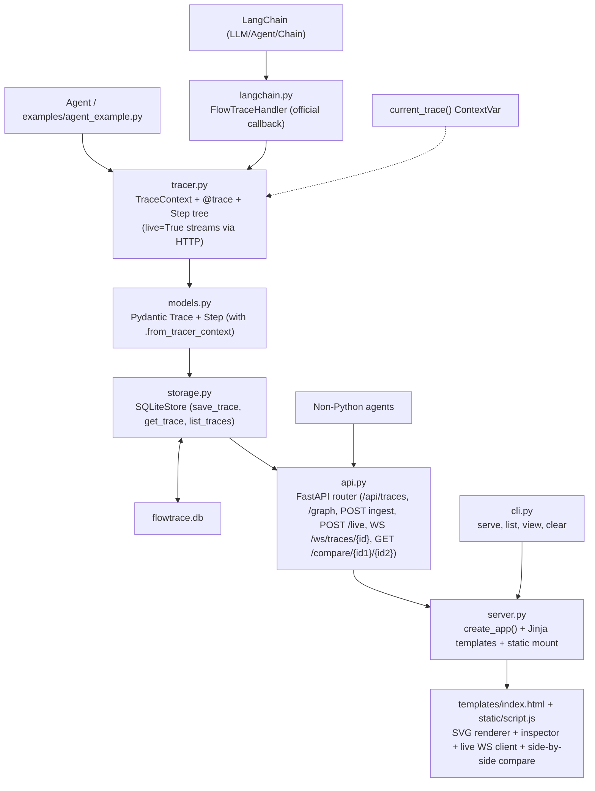

<!-- header:start -->
<div align="center">



<a href="#-quick-start"></a>

<a href="LICENSE"></a>

<a href="https://github.com/ajendras/flowtrace/stargazers"></a>
<a href="https://github.com/ajendras/flowtrace/actions/workflows/ci.yml"></a>

<a href="CONTRIBUTING.md"></a>

**Visualizes and debugs multi-step LLM agent workflows with interactive graphs and local inspection**

[✨ Features](#-features) • [⚡ Quick start](#-quick-start) • [🧰 Usage](#-usage) • [🧩 Architecture](#-architecture) • [📍 Roadmap](#-roadmap) • [🤝 Contributing](#-contributing)

</div>
<!-- header:end -->

## ✨ Why FlowTrace?

AI agents chain dozens of LLM calls, tool invocations, memory reads, and nested logic, yet failures remain opaque black boxes. Cloud observability platforms are expensive and framework-specific, while log-based tools drown you in noise. FlowTrace is a lightweight, local-first dashboard that auto-instruments *any* Python agent code and renders clean interactive SVG graphs—so you can instantly see what happened, why it failed, and how to fix it.

- Zero-config tracing with a single `@trace` decorator or context manager—no framework lock-in
- Official LangChain callback handler for zero-code instrumentation of any chain, agent, LLM or tool
- Interactive SVG node-link diagrams that visualise nesting, timing, step kinds, and data flow on a strict grid
- Clickable inspector panels showing raw prompts, responses, token counts, tool arguments, latency, and errors
- Local SQLite persistence with history browsing, trace replay (mocked tools), HTTP ingestion for non-Python agents, and summary statistics

## 🎬 Demo

<p align="center"></p>

## 🚀 Features

<table>
<tr>
<td align="center" valign="top" width="33%">
🔌 <b>Zero-config tracing</b><br>
Decorator, context manager, and official LangChain callback handler
</td>
<td align="center" valign="top" width="33%">
📈 <b>Interactive SVG graphs</b><br>
Strict hierarchical grid showing flow, nesting and timing
</td>
<td align="center" valign="top" width="33%">
🔎 <b>Prompt inspector</b><br>
Click any node for raw prompts, responses, tokens and metadata
</td>
</tr>
<tr>
<td align="center" valign="top">
🛠️ <b>Tool call browser</b><br>
Every invocation with arguments, output and caller location
</td>
<td align="center" valign="top">
💾 <b>Local persistence</b><br>
SQLite store with history, filtering, side-by-side comparison
</td>
<td align="center" valign="top">
▶️ <b>Trace replay</b><br>
Re-execute saved traces with mocked tools
</td>
</tr>
<tr>
<td align="center" valign="top">
📡 <b>HTTP ingestion</b><br>
POST endpoint for non-Python or remote agents
</td>
<td align="center" valign="top">
🔴 <b>Live streaming</b><br>
WebSocket endpoint — traces appear live as they run
</td>
<td align="center" valign="top">
📊 <b>Summary statistics</b><br>
Token usage, success rate, slowest steps and failure patterns
</td>
</tr>
<tr>
<td align="center" valign="top" colspan="3">
🔄 <b>Side-by-side comparison</b><br>
Select any two traces to view aligned SVG graphs, stats, and computed differences
</td>
</tr>
</table>

## 📦 Installation

Requires **Python 3.9+**. No external services or database servers needed.

```bash
pip install flowtrace
```

For LangChain support:

```bash
pip install "flowtrace[langchain]"
```

Start the Swiss-minimal dashboard:

```bash
flowtrace serve
```

Open http://127.0.0.1:8080. The server also registers the `/api/traces` endpoints automatically.

## ⚡ Quick start

```python
from flowtrace import trace, current_trace

@trace("ResearchAgent")
def research(query: str):
    tc = current_trace()
    tc.record_llm_call(
        prompt=f"Summarize research on: {query}",
        response="Agents need observability...",
        tokens=124,
        latency=0.38
    )
    tc.record_tool_call(
        name="wikipedia",
        args={"query": query},
        result={"summary": "Key concepts..."}
    )
    return "final answer"

from flowtrace import TraceContext
with TraceContext(name="DemoWorkflow", live=True):
    research("LLM observability")
```

Run `flowtrace serve` in another terminal and visit the UI. Your trace appears instantly (and builds live via WebSocket) with an interactive graph.

**With LangChain (zero-code):**

```python
# pip install "flowtrace[langchain]" langchain-core langchain-openai
from langchain_openai import ChatOpenAI
from langchain_core.tools import tool
from flowtrace import FlowTraceHandler

handler = FlowTraceHandler(name="ResearchAgent", live=True)

llm = ChatOpenAI(model="gpt-4o-mini", callbacks=[handler])

@tool
def wikipedia(query: str):
    """Look up information on Wikipedia."""
    return "Agent observability is essential..."

# Pass the handler to any chain/agent/LLM
# agent = create_react_agent(llm=llm, tools=[wikipedia], ...)
# agent.invoke(...)  # trace saved automatically
```

## 🧰 Usage

### Manual context with steps

```python
from flowtrace import TraceContext

with TraceContext(name="CustomerSupportAgent") as tc:
    tc.record_step("Load user profile", "setup")
    tc.record_step("Log event")  # kind defaults to "step"
    
    with tc.step("Generate response", "phase"):
        tc.record_llm_call("You are a helpful agent...", "Here is your refund link", 87)
        tc.record_tool_call("get_order", {"order_id": 42}, {"status": "shipped"})
```

### Live streaming

Enable real-time WebSocket updates so the dashboard graph builds node-by-node while your agent runs (works with both manual `TraceContext` and the LangChain handler):

```python
from flowtrace import TraceContext, current_trace

with TraceContext(name="LiveResearchAgent", live=True) as tc:
    tc.record_llm_call(...)
    tc.record_tool_call(...)
    # UI updates instantly via /api/ws/traces/{id}
```

Set `FLOWTRACE_SERVER_URL=http://127.0.0.1:9000` if you use a non-default port.

### LangChain zero-code instrumentation

```python
from flowtrace import FlowTraceHandler
from langchain_core.callbacks import BaseCallbackHandler

handler = FlowTraceHandler(name="MyAgent", live=True)

# Pass to any LangChain component
llm = ChatOpenAI(callbacks=[handler])
# or agent = initialize_agent(..., callbacks=[handler])
# or chain = prompt | llm with config={"callbacks": [handler]})
```

The handler automatically:
- Creates a `TraceContext` on first event
- Builds a nested step tree using LangChain's `run_id`/`parent_run_id`
- Records LLM prompts/responses/tokens, tool inputs/outputs, chain steps
- Finalizes timing and persists the trace to SQLite when the root run completes

### Side-by-side trace comparison

In the dashboard, use the checkboxes next to traces in the history list to select exactly two traces, then click **Compare** in the header. The main view switches to a split layout with:

- Two interactive SVG graphs placed side-by-side (strict hierarchical grid layout preserved for each trace)
- Summary statistics for both traces
- A differences panel showing duration delta, token usage delta, and step count delta
- A shared inspector: click any node in either graph to see its prompt/response/tool data, with visual indication of which trace it belongs to

Exit comparison mode with the **Single View** button to return to the standard inspector+graph layout. This makes it trivial to spot regressions, performance changes, or differences in agent behaviour across runs.

### CLI inspection

```bash
flowtrace list --limit 10
flowtrace view 8f3c9a2b-...
flowtrace serve --port 9000 --host 0.0.0.0
```

### Ingest from any language

```python
import requests
requests.post(
    "http://127.0.0.1:8080/api/traces",
    json={...}  # Trace model shape from models.py
)
```

<details><summary>Advanced: Custom step kinds and error recording</summary>

```python
with tc.step("MemoryRead", "memory", {"key": "user:123"}):
    ...

# record_step can omit the kind (defaults to "step")
tc.record_step("Quick note")

# Errors are automatically captured by the context manager
with tc.step("RiskyAPI"):
    raise ValueError("Rate limit exceeded")
```
</details>

<details><summary>Advanced: Replaying a saved trace with mocks</summary>

Load a trace via the UI or `flowtrace view`, then replay it while overriding tool calls using the same `record_tool_call` hooks with deterministic results.
</details>

## 🔧 Configuration

<table>
<thead>
<tr><th>Option</th><th>Default</th><th>Description</th></tr>
</thead>
<tbody>
<tr>
<td><code>port</code></td>
<td><code>8080</code></td>
<td>Port the dashboard listens on (<code>flowtrace serve --port 9000</code> or <code>run_server(port=9000)</code>)</td>
</tr>
<tr>
<td><code>host</code></td>
<td><code>"127.0.0.1"</code></td>
<td>Bind address for the server (<code>--host 0.0.0.0</code> for external access)</td>
</tr>
<tr>
<td><code>db_path</code></td>
<td><code>"flowtrace.db"</code></td>
<td>SQLite file path passed to <code>SQLiteStore(db_path=...)</code></td>
</tr>
<tr>
<td><code>limit</code></td>
<td><code>20</code> (CLI) / <code>50</code> (API)</td>
<td>Number of traces returned by <code>list_traces(limit=...)</code> or <code>flowtrace list --limit 50</code></td>
</tr>
<tr>
<td><code>live</code></td>
<td><code>false</code></td>
<td>Enable real-time WebSocket streaming (<code>TraceContext(..., live=True)</code> or <code>FlowTraceHandler(..., live=True)</code>; respects <code>FLOWTRACE_SERVER_URL</code> env var)</td>
</tr>
</tbody>
</table>

## 🧩 Architecture



`TraceContext` builds a nested `Step` tree using `perf_counter` timing and `contextvars` for async/thread safety. The tree is converted to Pydantic models, persisted as JSON in SQLite (with denormalised summary fields), and served to a single-page Swiss-minimal frontend that renders an interactive SVG graph on a strict hierarchical grid. All public APIs (`trace`, `TraceContext`, `run_server`, `FlowTraceHandler`, CLI commands) are defined in the shown source files.

## 📁 Project structure

```text
.
├── pyproject.toml                 # Metadata, dependencies, console script entrypoint
├── src/flowtrace/
│   ├── __init__.py                # Public API: trace(), TraceContext, current_trace(), run_server(), FlowTraceHandler
│   ├── langchain.py               # Official LangChain BaseCallbackHandler (zero-code)
│   ├── tracer.py                  # Core TraceContext, Step dataclass, @trace decorator, record_llm_call/record_tool_call
│   ├── models.py                  # Pydantic Trace, Step (with from_tracer_context), TraceSummary
│   ├── storage.py                 # SQLiteStore with create_tables, save_trace, get_trace, list_traces, clear_all
│   ├── api.py                     # FastAPI router: /api/traces (GET/POST), /{id}, /{id}/graph
│   ├── cli.py                     # Typer CLI: serve(--port, --host), list(--limit), view, clear
│   ├── server.py                  # create_app() that mounts static files, Jinja templates and API router
│   └── ...
├── templates/index.html           # Single-page Swiss-minimal UI (12-column grid, sidebar, SVG canvas, inspector)
├── static/
│   ├── script.js                  # Vanilla JS: loadTraces(), renderGraph() (strict grid SVG), onNodeClick(), inspector
│   └── styles.css                 # Strict Swiss design: #e30613 accent, hairline rules, system-ui, no shadows
├── tests/test_tracer.py           # pytest suite for context, decorator, nesting, timing, errors, uniqueness, LangChain handler
└── examples/agent_example.py      # Runnable mock research agent demonstrating realistic usage + LangChain handler
```

## 🧪 Testing

```bash
pip install -e ".[test,langchain]"
pytest
```

The test suite (`tests/test_tracer.py`) covers `TraceContext` nested step construction, `@trace` decorator behaviour (both top-level and nested), LLM/tool recording, timing accuracy, error capture, `current_trace()` contextvar semantics, UUID uniqueness, and the LangChain `FlowTraceHandler` (with mocked callbacks and store).

## 📍 Roadmap

<!-- roadmap:start -->
- [x] **v0.1.0** — first release: Zero-config tracing, Interactive graphs, Prompt inspector, Tool call browser
- [x] Add official LangChain callback handler for zero-code instrumentation
- [x] Implement WebSocket endpoint for live trace streaming during runs
- [x] Build side-by-side trace comparison view
- [ ] Add search across prompts and tool outputs in trace history
- [ ] Create first-party LlamaIndex integration adapter
- [ ] Export traces to OpenTelemetry / LangSmith compatible format
- [ ] Add latency flamegraph and per-step token analytics dashboard
- [ ] Support manual annotations and comments on any step
- [ ] Implement trace replay with swapped model parameters or mocked outputs
- [ ] Add plugin system for custom step visualizers and badges
- [ ] Provide official Docker image with one-command deployment
- [ ] Support non-Python agents via OpenTelemetry auto-instrumentation

> 🤖 This roadmap is worked through continuously — ideas and PRs welcome!
<!-- roadmap:end -->

## 🤝 Contributing

Contributions are welcome and appreciated! Please read [CONTRIBUTING.md](https://github.com/ajendras/flowtrace/blob/main/CONTRIBUTING.md) and adhere to the [CODE_OF_CONDUCT.md](https://github.com/ajendras/flowtrace/blob/main/CODE_OF_CONDUCT.md). Good first issues are tagged and make excellent PR starting points. Feel free to open an issue or PR against the Swiss-minimal dashboard, the SVG layout algorithm, or the tracer internals.

## 📄 License

MIT © FlowTrace Contributors. See [LICENSE](https://github.com/ajendras/flowtrace/blob/main/LICENSE) for details.

<!-- footer:start -->
<div align="center">

### ⭐ Star history

<a href="https://star-history.com/#ajendras/flowtrace&Date"></a>

If **FlowTrace** saves you time, a ⭐ helps others find it.

Made with ❤️ by [Ajendra](https://ajendra.info)


</div>
<!-- footer:end -->
